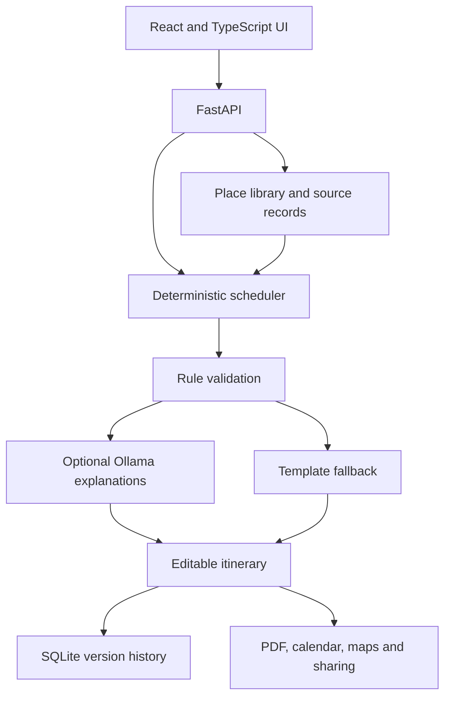

# AI Travel Planner Agent

**An editable itinerary workflow built around sourced place data, deterministic scheduling, and optional local LLMs.**

`In active development` · `Python / FastAPI` · `React / TypeScript` · `SQLite` · `Ollama`

[中文文档](README.zh-CN.md) · [Architecture and specifications](specs/README.md) · [Validation](VALIDATION.md)

Turn travel preferences into a day-by-day itinerary that can be checked, edited, versioned, and exported. The application interface is currently Chinese; this overview is for international readers.

## What this project explores

I am building this personal project to explore how agent-style workflows can combine natural-language input with explicit rules and testable software. The central design decision is to keep scheduling and factual constraints outside the language model.

- **Deterministic planning:** route structure, opening-day checks, meals, travel buffers, and validation are handled by Python.
- **Sourced facts:** place information carries source records; model-generated URLs are not accepted as facts.
- **Optional LLM assistance:** natural-language intake, note extraction, and narrative explanations. Core itinerary generation has a template fallback when a model is unavailable.
- **User control:** edits, locks, replacement candidates, undo/redo, saved versions, comparison, and rollback.

## Current capabilities

| Area | Implemented workflow |
| :--- | :--- |
| Planning | Theme-based and cultural-route itineraries; multi-city trips; destination-data generation |
| Editing | Drag/reorder, lock/remove/replace, natural-language edits, date shifts, version history |
| Travel details | Budget estimates, weather, booking constraints, checklists, private local attachments |
| Delivery | PDF, HTML/Markdown, image exports, ICS calendar, KML map, read-only sharing |
| Maps | OpenStreetMap, optional Amap integration for mainland China |
| Evaluation | Rule validation, scheduling evaluation scripts, optional LLM-judge experiments, unit and browser tests |

Curated destinations and automatically generated city data have different coverage. Generated data is presented as provisional; availability and travel facts still need current source checks. This is an evolving local application, not a hosted production service.

## Architecture



## Run locally

Python 3.11+ and Node.js 20+ are required. For local model assistance, install Ollama and pull `qwen2.5:7b-instruct`.

```bash
git clone https://github.com/Kylie08ky/ai-travel-planner-agent.git
cd ai-travel-planner-agent
python -m venv .venv

# Windows PowerShell: .venv\Scripts\Activate.ps1
# Linux/macOS: source .venv/bin/activate
pip install -e ".[dev]"
python -m playwright install chromium
python -m uvicorn app.api:app --host 127.0.0.1 --port 8137
```

In another terminal:

```bash
cd web
npm ci
npm run dev
```

Open `http://localhost:5173`. The API documentation is at `http://127.0.0.1:8137/docs`. Copy `.env.example` to `.env` only if you need to customize optional providers; supply your own credentials. Model-free development can use `LLM_BACKEND=stub`.

Docker setup and additional commands are in the [Chinese guide](README.zh-CN.md).

## Tests

```bash
python -m pytest -q                 # Default: excludes integration and browser tests
python -m ruff check .
cd web && npm run build
# From repository root, with browser dependencies installed:
python -m pytest -m e2e tests/e2e
```

See [VALIDATION.md](VALIDATION.md) for what was actually checked for this publication snapshot.

## Development status

The current development focus is delivery polish: a reproducible demo, consolidated evaluation reports, and self-hosting documentation. Collaboration/accounts and other deferred features are not presented as complete. See [the roadmap](specs/04-versions-and-roadmap.md).

This first public snapshot was prepared on **2026-11-06** from the current working tree. It includes in-progress changes and starts a clean public history. Local trip databases, uploaded attachments, cookies, credentials, caches, and generated private outputs are excluded.

## Data and attribution

Place and media attribution records are preserved with the data, including Wikimedia/other source references used by the application. External services, datasets, images, and dependencies retain their respective terms. This snapshot adds no blanket license over third-party material.
