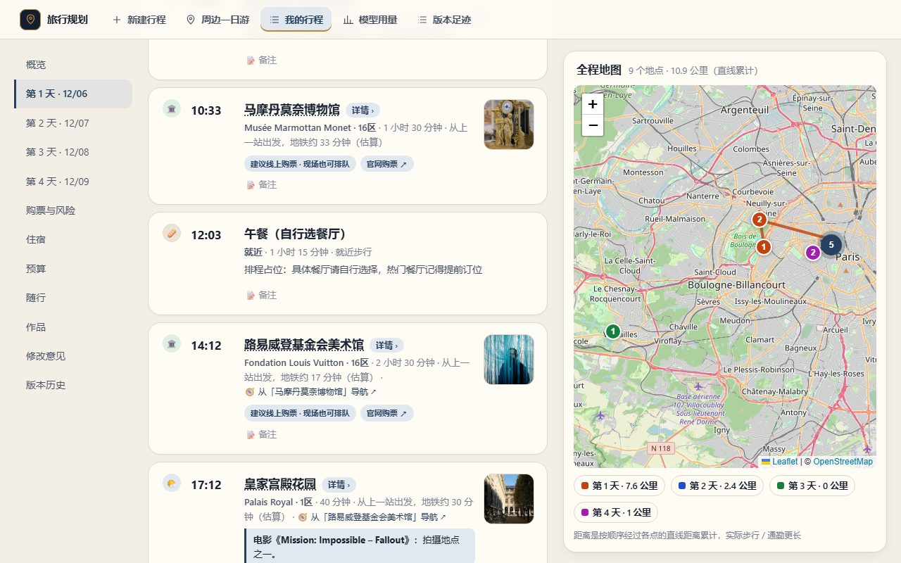
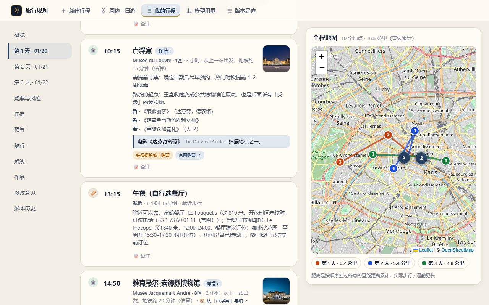

# AI Travel Planner Agent

Turn "a few days in some city" into a day-by-day itinerary you can check, edit, and export. Built for Chinese-speaking travellers; the app interface is in Chinese.

[中文说明](README.zh-CN.md) · [Validation](VALIDATION.md) · [Evaluation](docs/evaluation.md) · [Self-hosting](docs/self-hosting.md)

## What it does

- **Plan:** pick themes or a cultural route, or just type a sentence. Any city or country works; several cities can share one itinerary.
- **Trust the facts:** opening days, links, and prices come from sourced data, never from a language model. Automatically built cities are marked as provisional.
- **Edit freely:** drag, lock, swap, undo, and roll back to earlier versions.
- **Take it with you:** PDF, calendar (ICS), map file (KML), long image, or a read-only share link. Works on a phone.
- **Local model optional:** a local LLM only phrases the descriptions. Without one, templates are used.

## Screenshots



| Home | Deep route itinerary | Mobile |
|---|---|---|
|  |  |  |

A 7-minute walkthrough is in [docs/demo.md](docs/demo.md) (Chinese); how it was evaluated is in [docs/evaluation.md](docs/evaluation.md).

## Run it

Python 3.11+ and Node.js 20+. Optional: [Ollama](https://ollama.com) with `qwen2.5:7b-instruct`.

```bash
python -m venv .venv
# Windows: .venv\Scripts\Activate.ps1    Linux/macOS: source .venv/bin/activate
pip install -e ".[dev]"
python -m playwright install chromium
python -m uvicorn app.api:app --port 8137
```

In another terminal:

```bash
cd web
npm ci
npm run dev
```

Open http://localhost:5173. Without Ollama, set `LLM_BACKEND=stub` in `.env` (copy `.env.example`). A map key for mainland China is optional.

## Limits

- Only Paris is fully curated. For ten Italian cities, official links and closing days were checked for part of their places; all other cities are built automatically from open data, so check prices, bookings and opening days against official sources. Coverage numbers are in [the evaluation report](docs/evaluation.md).
- Single user, no accounts. This is a local app, not a hosted service.

## License

[MIT](LICENSE). Third-party data and images keep their own licenses and attribution.
