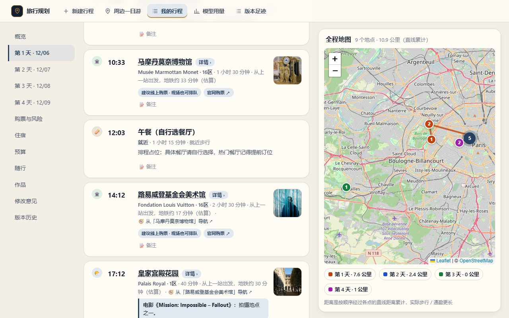
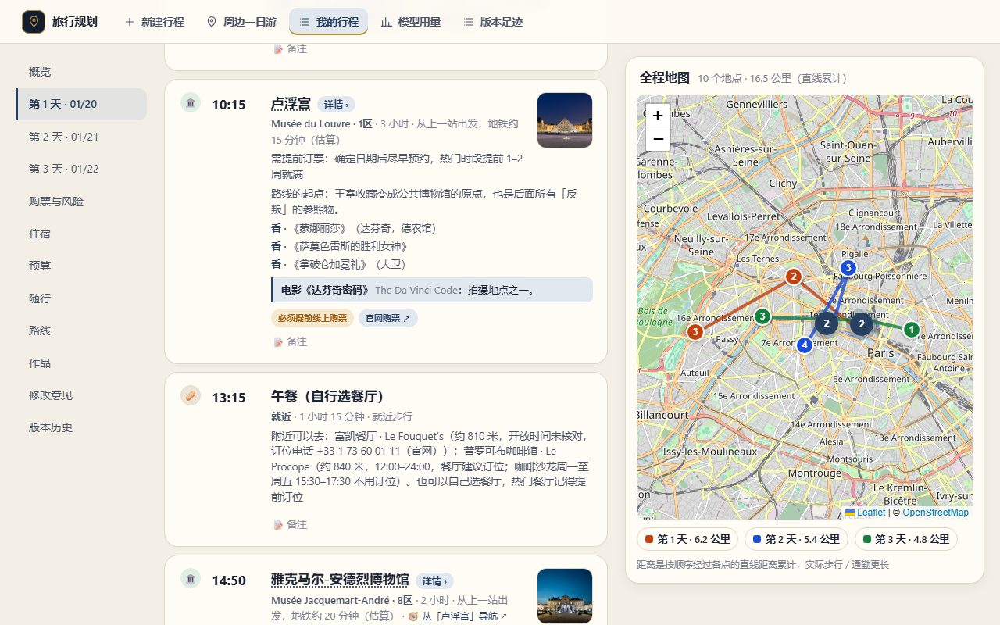

# AI 旅行规划 Agent

把「去某个城市玩几天」变成一份可以核对、修改、导出的每日行程。面向中国游客，国内外都能规划。

[English](README.md) · [验证说明](VALIDATION.md) · [评测报告](docs/evaluation.md) · [自托管](docs/self-hosting.md)

## 能做什么

- **生成**：选主题或一条深度路线，或者直接写一句话。任意城市、国家都行；多座城市可以放进同一份行程。
- **事实可信**：开放日、官网链接、价格来自带来源的数据，不信模型给的网址。自动现建的城市会标明「数据是自动建的」。
- **随便改**：拖拽、锁定、换一个、撤销，每次保存都是一个版本，能回滚。
- **带着走**：PDF、日历（ICS）、地图文件（KML）、长图、只读分享链接；手机可用，离线能看。
- **模型可选**：本地模型只负责把说明写顺，没有模型就用模板。

## 截图



| 首页 | 深度路线行程 | 手机 |
|---|---|---|
|  |  |  |

7 分钟演示脚本见 [演示脚本](docs/demo.md)，质量怎么评的见 [评测报告](docs/evaluation.md)。

## 跑起来

需要 Python 3.11+ 和 Node 20+。想要模型写说明，装 [Ollama](https://ollama.com) 并拉取 `qwen2.5:7b-instruct`（不装也能用）。

```bash
python -m venv .venv
.venv\Scripts\activate
pip install -e ".[dev]"
playwright install chromium
python -m uvicorn app.api:app --port 8137
```

另开终端：

```bash
cd web
npm install
npm run dev
```

打开 http://localhost:5173。没装 Ollama 就在 `.env` 里写 `LLM_BACKEND=stub`（先复制 `.env.example`）。国内行程想用高德，在 `.env` 里填你自己的 Key，不填也能用。也可以用 `docker compose up --build`。

## 已知局限

- 只有巴黎是完整精校的；意大利十座城市补核了一部分地点的官网和闭馆日；其余城市都是用开放数据自动现建的，价格、预约、开放时间要以官网为准。各城市的核对覆盖率见[评测报告](docs/evaluation.md)。
- 本地小模型写的说明偶尔不合格，会自动换成模板。
- 单人使用，没有账号和协作；这是本地应用，不是在线服务。

## 许可证

[MIT](LICENSE)。第三方图片和数据各自保留许可证与署名。
